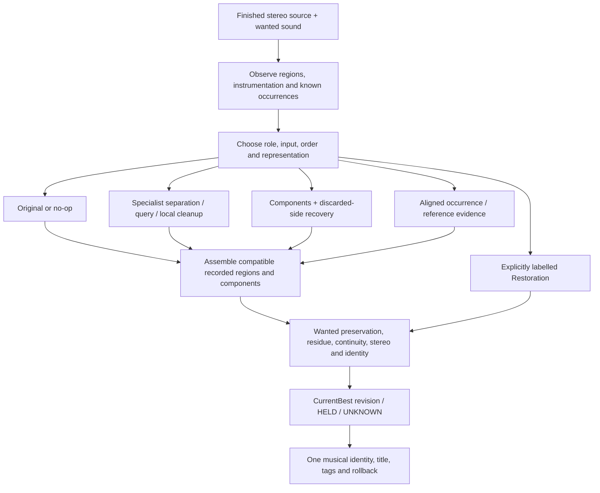

# LSS Technology Map

Generated from `technology_ledger.json` by `python scripts/technology.py map`. The ledger owns current scoped records; original Evidence and live artifacts remain authoritative. Do not maintain another hand-written technology scoreboard here.

## One axis: useful wanted audio

The goal is a useful standalone wanted asset from a finished 2ch mix, autonomously and locally. Singing/choir remains wanted music. Single-occurrence/no-reference processing remains first-class. Existing released material is an identity/redundancy question. Unknown material survives. Recorded extraction and generated/restored material stay distinct. The user chooses wanted sound, not checkpoints or A/B winners. Intent owner: [PRODUCT_INTENT](../product/PRODUCT_INTENT.md); processing/order contract: [SOURCE_TO_ASSET](../engine/SOURCE_TO_ASSET.md); donor/identity rules: [RECOVERY_AND_REFERENCES](../engine/RECOVERY_AND_REFERENCES.md).



This is the decision space, not a claim that every branch is implemented. The records below distinguish shipped/source/research and exact tested roles.

## Find before choosing or reinstalling

Run with the current checkout Python (`.venv/Scripts/python.exe`). These commands do not download, load a model, run inference or touch credentials.

```text
python scripts/technology.py search "SAM Audio"
python scripts/technology.py show sam-audio
python scripts/technology.py assets sam-audio
python scripts/technology.py search "dialogue-first"
python scripts/technology.py search "sample rate"
python scripts/technology.py check --freshness
python scripts/technology.py coverage
```

`assets` stats only the declared files in the development/installed model roots and optional `LSS_MODEL_DIR`. `--hash` explicitly reads those weights to compare identity; even HASH_MATCH is not an inference/readiness test. A missing file at one root does not establish authentication failure or global absence. Complete existing asset sets are returned as reuse locations: point the development job's `LSS_MODEL_DIR` at that store instead of downloading again. When physical placement must change, use a verified relocation and update all owning references together ([DATA_LIFECYCLE](../dev/DATA_LIFECYCLE.md)); preserve the installed runtime's access. `search` normalizes spaces/hyphens/underscores; `--json` before the subcommand returns every matched original section with its full context. Ordinary output shows a bounded excerpt plus the exact source location. No indexed match means UNKNOWN.

## Current role map

Reviewed 2026-11-04; 36 technology/method records. Adoption is recorded scope, not a live installed-runtime check. Use `show <id>` for input, ordered assembly, population, observed result, reopening condition and sources.

| Family | Lookup ID / technology | Implementation and adoption boundary |
|---|---|---|
| query-separation | `sam-audio` — SAM Audio | Named-sound route shipped; SOUND development paused. BGM trials are separate research. |
| separation | `sfc-locoformer` — SFC-Locoformer DnR medium | Shipped BGM analyzer and SOUND DnR node |
| separation | `instrumental-deux` — becruily deux / instrumental specialists | Shipped INSTRUMENTAL; legacy model TSV states are only that slot |
| separation | `bandit` — Facing the Music BandIt / BandIt v2 | Shipped singing recovery; direct replacement research not adopted |
| separation | `scnet` — SCNet XL IHF / SCNet research | Shipped 4-stem node |
| separation | `karaoke-chorus` — Karaoke lead/backing and male/female specialists | SOUND shipped; model-stem semantics separate from Product target registration |
| separation | `hyperace` — HyperACE v2 instrumental | Research lead only; not Product default |
| separation | `dialogue-consensus` — Local dialogue-residual instrumental consensus | Shipped BGM local dialogue cleanup |
| separation | `musicless` — Musicless / Y10-dependent research routes | Research only; separate from shipped instrumental-consensus cleanup |
| separation | `sfx-removers` — FX MDX23C, Jasper/Jazzpear category removers | Research cells mostly no gain; no family-wide exclusion |
| query-separation | `query-tools` — AudioSep, USS, CLAPSep, TUSS, Hive | Research only for listed music roles |
| separation | `separator-alternatives` — MRX, TIGER, DBS-TIGER, MIMO, Big Beta 6X | Not adopted as general replacements |
| assembly | `instrument-reassembly` — SW6, Mega53 and instrument specialists / Drumsep | Method open; uniform full-cue reproduction claim withdrawn |
| assembly | `transformed-passes` — Speed/pitch/polarity/shift passes and ensembles | Tried; means are research leads, max has scene-sound risk |
| assembly | `residual-reseparation` — Boosted residual and discarded-stem recovery | Tried cells no useful gain; other roles open |
| assembly | `phase-spatial` — Phase fixer, Mid/Side and spatial refinement | Some scoped analyzer/refiner roles; no global M/S recipe |
| assembly | `repetition-lowrank` — REPET-SIM, RPCA and spectral dictionaries | Listed cells not adopted |
| query-separation | `guidesep-mus3d` — GuideSep / MuS3D query and blind component tools | Not new intake; automatic guidance trials not adopted |
| assembly | `fastmnmf` — FastMNMF2 / blind spatial separation | Not adopted for tested cells |
| recovery | `occurrence-memory` — Occurrence memory and cross-episode identity | Shipped scoped memory; recall and complete-form assembly open |
| recovery | `occurrence-splicing` — Cleanest-occurrence splicing and dialogue-first combinations | Research only for splicing combinations |
| identity | `reference-identity` — Released recording identity and scoped EXACT | Product implementation; recognition recall and late-reference follow-through open |
| identity | `soundprint-sampleid` — SoundPrint / SampleID / CLEWS / Fish candidate retrieval | Research candidates, not whole-span skip authorization |
| identity | `version-relations` — Chroma/CENS, 2D-FTM, DTW, key-invariant matching | Related-version research; not EXACT |
| formation | `cue-formation` — BGM detection, quiet gaps, boundaries and continuity | Shipped extent capabilities; short and gap cases remain scoped |
| formation | `short-assets` — Short BGM and short named-effect removal | Scoped source/package evidence; broad short recall remains unknown |
| analysis | `tagging-instrumentation` — PANNs AudioSet, PE-A-Frame, CLAP and instrument evidence | Shipped evidence tools; not quality or absence oracles |
| evaluation | `quality-evaluation` — Wanted retention, ODAQ, Audiobox Aesthetics and residue meters | No single general no-reference quality selector |
| restoration | `restoration` — MSR/X-LANCE/MelRNN, inpainting and rhythm-tail restoration | Separate representation, not faithful extraction or recovered master |
| scene-naming | `scene-understanding` — Scene evidence: ASR, OCR, video/audio understanding | Native naming runtime shipped; ASR withheld, scene-grounded names unavailable in installed release |
| scene-naming | `naming-metadata` — Identity-wide song-like naming and music-library metadata | Shipped provisional names with identity collisions/revision gaps |
| runtime | `native-runtime` — stems.cpp Vulkan / CUDA and resident native request context | Development only; no Product route registered |
| runtime | `local-language-runtime` — On-demand local LLM/ASR and development memory | Native Product naming runtime and separate Development assistants |
| product-integrity | `lineage-publication` — Recipe, CurrentBest, provenance, reuse and rollback | Shipped; exact claims and failure history in acceptance ledger |
| identity | `reference-acquisition` — Release discovery, acquisition and late-reference redecision | Shipped discovery; late-arrival revision has separate development work |
| external-intake | `external-leads-20261113` — External leads not yet tried (2026-11-13 search): SAM Audio Judge, CineAudioDB, cross-version common-signal / deformed-reference NMF, TVSM, AV-CASS, llama.cpp audio input, BAF fingerprinting | Untried leads; each names the existing role it could serve and its falsifier |

## A pattern is more than a model name

A role record contains: **use × checkpoint/config × input/parent × channel/representation × stage order × conditioning × assembly × population**. A load/dependency failure is not a quality result; a whole-cue failure does not close a dirty-stem role. A mean, maximum, subtraction, mask projection and generated repair are different assemblies. Direct music selection, candidate retrieval and whole-span EXACT are different permissions.

**Known contradictions resolved by scope:** SAM base-tv is implemented and its cached Product weights are a different question from official gated repository access or earlier small-model temporal trials. HyperACE standard-loader failure is superseded by successful own-module execution. The legacy Instrumental TSV is not the status of every possible use. Guide speed/pitch, residual boost, ensembles, USS and splicing already have executed cells; they are technique families with remaining patterns, not blanket untried proposals. Uniform instrument chains do not constitute the practitioner's per-cue method.

## Coverage and recoverable originals

Curated cross-pipeline roles plus all sections/rows of declared sources, including active research ledgers, legacy model TSV and the five user-supplied guides/map (HTML retained with visible-text derivative). Supplied scores/advice remain reference material, not measured Product state or instructions. Not every raw historical JSON/audio/log; unregistered patterns remain UNKNOWN. Historical running markers are not live process observations.

Every heading and table in each declared Markdown source, and every row/column of the legacy model TSV, participates in lookup. Numeric rows are not automatically converted to adoption decisions. Full-section context retains baselines, denominators, limitations and corrections. Follow-ref freshness compares the pinned file blob with the current declared branch, not commit dates or branch-head equality. Archived/missing follow refs retain the pinned source but are reported for review. It does not discover new unregistered files.

| Source ID | Immutable locator | Scope |
|---|---|---|
| `intent` | `01d6b5b35019:docs/product/PRODUCT_INTENT.md` | Existing owner/result; historical claims retain their original scope. Runtime and exact artifacts outrank this snapshot. |
| `recipe-contract` | `01d6b5b35019:docs/engine/SOURCE_TO_ASSET.md` | Existing owner/result; historical claims retain their original scope. Runtime and exact artifacts outrank this snapshot. |
| `recovery-contract` | `01d6b5b35019:docs/engine/RECOVERY_AND_REFERENCES.md` | Existing owner/result; historical claims retain their original scope. Runtime and exact artifacts outrank this snapshot. |
| `sound-contract` | `01d6b5b35019:docs/engine/WANTED_SOUND.md` | Existing owner/result; historical claims retain their original scope. Runtime and exact artifacts outrank this snapshot. |
| `quality-contract` | `01d6b5b35019:docs/engine/QUALITY_AND_DECISIONS.md` | Existing owner/result; historical claims retain their original scope. Runtime and exact artifacts outrank this snapshot. |
| `naming-contract` | `01d6b5b35019:docs/engine/LISTENING_AND_PRESENTATION.md` | Existing owner/result; historical claims retain their original scope. Runtime and exact artifacts outrank this snapshot. |
| `runtime-contract` | `docs/engine/LOCAL_RUNTIME.md (SHA-256 0aa0634b6830…)` | Current versioned owner, SHA-bound: native packaged naming versus source-only Transformers; ASR_UNVERIFIED and scene-grounding gap remain separate. Previous prose is retained in Git. |
| `acceptance-index` | `01d6b5b35019:docs/validation/INDEX.md` | Existing owner/result; historical claims retain their original scope. Runtime and exact artifacts outrank this snapshot. |
| `model-ledger` | `01d6b5b35019:ledger/models.tsv` | Existing owner/result; historical claims retain their original scope. Runtime and exact artifacts outrank this snapshot. |
| `model-survey` | `01d6b5b35019:model-survey-evidence/SURVEY_20261021.md` | Existing owner/result; historical claims retain their original scope. Runtime and exact artifacts outrank this snapshot. |
| `sound-bench-index` | `01d6b5b35019:release-evidence/wanted-sound/README.md` | Existing owner/result; historical claims retain their original scope. Runtime and exact artifacts outrank this snapshot. |
| `sound-bench` | `01d6b5b35019:release-evidence/wanted-sound/EVIDENCE.md` | Existing owner/result; historical claims retain their original scope. Runtime and exact artifacts outrank this snapshot. |
| `regional-results` | `01d6b5b35019:bgm-region-evidence/RESULTS.md` | Existing owner/result; historical claims retain their original scope. Runtime and exact artifacts outrank this snapshot. |
| `components` | `01d6b5b35019:component-evidence/RESULTS.md` | Existing owner/result; historical claims retain their original scope. Runtime and exact artifacts outrank this snapshot. |
| `precision` | `01d6b5b35019:precision-evidence/RESULTS.md` | Existing owner/result; historical claims retain their original scope. Runtime and exact artifacts outrank this snapshot. |
| `short-bgm` | `01d6b5b35019:short-evidence/RESULTS.md` | Existing owner/result; historical claims retain their original scope. Runtime and exact artifacts outrank this snapshot. |
| `short-effects` | `01d6b5b35019:transient-evidence/RESULTS.md` | Existing owner/result; historical claims retain their original scope. Runtime and exact artifacts outrank this snapshot. |
| `stereo-tagging` | `01d6b5b35019:stereo-tag-evidence/RESULTS.md` | Existing owner/result; historical claims retain their original scope. Runtime and exact artifacts outrank this snapshot. |
| `scene-observation` | `01d6b5b35019:scene-web-evidence/SOURCE_VISUAL_RESULTS.md` | Existing owner/result; historical claims retain their original scope. Runtime and exact artifacts outrank this snapshot. |
| `scene-runtime` | `01d6b5b35019:scene-runtime-evidence/PACKAGE.md` | Existing owner/result; historical claims retain their original scope. Runtime and exact artifacts outrank this snapshot. |
| `local-development-ai` | `01d6b5b35019:release-evidence/local-ai-practical-20261026/RESULTS.md` | Existing owner/result; historical claims retain their original scope. Runtime and exact artifacts outrank this snapshot. |
| `rotation` | `9759fd77f7a8:evidence/rotation/TRIALS.md` | Research only. Original section, population, table and qualification stay together; not a Product adoption record. |
| `exploration` | `9759fd77f7a8:evidence/explore/REPORT.md` | Research only. Original section, population, table and qualification stay together; not a Product adoption record. |
| `exploration-rows` | `9759fd77f7a8:evidence/explore/table.md` | Research only. Original section, population, table and qualification stay together; not a Product adoption record. |
| `selector` | `9759fd77f7a8:evidence/salvage-select/REPORT.md` | Research only. Original section, population, table and qualification stay together; not a Product adoption record. |
| `practitioner-digest` | `9759fd77f7a8:evidence/salvage-select/practitioner-uvr-guide-digest.md` | Research only. Original section, population, table and qualification stay together; not a Product adoption record. |
| `spatial` | `30b37002b5a5:research/spatial-recovery-20261103/README.md` | Research/Development only; distinct pattern cells and exact artifact paths remain in the source. |
| `spatial-handoff` | `30b37002b5a5:research/spatial-recovery-20261103/HANDOFF-TO-CLAUDE.md` | Includes prior MuS3D execution locators and failed-intake versus inference distinctions. |
| `naming-distinct` | `72e206279def:release-evidence/naming-distinct-20261102/README.md` | Installed naming observation and separate not-deployed distinct-name improvement. |
| `sam-temporal` | `release-evidence/technology-ledger-20261104/prior/sam-temporal.md (SHA-256 9fe6de05ecfe…)` | Byte-identical historical report snapshot; local raw arrays/code stay at original_path. Old pending checklists are history, not live jobs. |
| `sam-repaired` | `release-evidence/technology-ledger-20261104/prior/sam-repaired.md (SHA-256 4ed65fe69734…)` | Byte-identical historical report snapshot; local raw arrays/code stay at original_path. Old pending checklists are history, not live jobs. |
| `headroom-repaired` | `release-evidence/technology-ledger-20261104/prior/headroom-repaired.md (SHA-256 57cd826127dc…)` | Byte-identical historical report snapshot; local raw arrays/code stay at original_path. Old pending checklists are history, not live jobs. |
| `breadth-history` | `release-evidence/technology-ledger-20261104/prior/breadth-history.md (SHA-256 9ff547c9ad85…)` | Byte-identical historical report snapshot; local raw arrays/code stay at original_path. Old pending checklists are history, not live jobs. |
| `supplied-position-map` | `release-evidence/development-flow-20261104/references/position-map-visible.md (SHA-256 6eb74a9a5459…)` | SUPPLIED_REFERENCE: practitioner guidance or provisional map, not local execution/adoption evidence. LSS 2ch/local/autonomous/no-agent-listening contracts govern; manual listening, surround and provisional scores do not override them. |
| `supplied-unreleased-guide` | `release-evidence/development-flow-20261104/references/unreleased-bgm-guide.md (SHA-256 e18ab6e6cb40…)` | SUPPLIED_REFERENCE: practitioner guidance or provisional map, not local execution/adoption evidence. LSS 2ch/local/autonomous/no-agent-listening contracts govern; manual listening, surround and provisional scores do not override them. |
| `supplied-separation-guide` | `release-evidence/development-flow-20261104/references/separation-guide.md (SHA-256 6967b1418ea8…)` | SUPPLIED_REFERENCE: practitioner guidance or provisional map, not local execution/adoption evidence. LSS 2ch/local/autonomous/no-agent-listening contracts govern; manual listening, surround and provisional scores do not override them. |
| `supplied-jukebox` | `release-evidence/development-flow-20261104/references/jukebox-excerpts.md (SHA-256 f26ea2c6a6b8…)` | SUPPLIED_REFERENCE: practitioner guidance or provisional map, not local execution/adoption evidence. LSS 2ch/local/autonomous/no-agent-listening contracts govern; manual listening, surround and provisional scores do not override them. |
| `supplied-recovery-exploration` | `release-evidence/development-flow-20261104/references/recovery-exploration.md (SHA-256 227ff0179a43…)` | SUPPLIED_REFERENCE: practitioner guidance or provisional map, not local execution/adoption evidence. LSS 2ch/local/autonomous/no-agent-listening contracts govern; manual listening, surround and provisional scores do not override them. |
| `reference-template-screen` | `research/reference-template-20261105/REPORT.md (SHA-256 c9061b854ce3…)` | Four-case source-local research screen; no Product promotion or episode-recall claim. |
| `real-quality-local-20261105` | `release-evidence/real-quality-20261105/REPORT.md (SHA-256 5bcbe0149723…)` | Development only: 42 reused approximate-reference intervals, historical cached Y10 versus standalone original-mix Musicless. No holdout, runtime chooser or Product default change. |
| `frontier-external-leads` | `98f3a4d9ebfe:docs/research/FRONTIER.md` | Section 'External leads not yet tried': public primary pages read on 2026-11-13; nothing downloaded, installed or run in LSS. |

## Keep this one record current

Before declaring a technology unavailable/untried, selecting a route or repeating a failed cell, search this entry, inspect its exact prior Evidence and check only the local assets the decision needs. Do not reinstall because a historical official URL was gated. If sources disagree, inspect implementation/artifact/measurement rather than voting or preferring the newest prose.

After a completed trial or changed installation/adoption, update the same technology role in `technology_ledger.json`: exact checkpoint/config, input, ordered assembly, population/controls, benefit/harm, decision, reopening trigger and durable source. Add a new role when a new pattern differs; retain prior outcomes through source provenance and Git. Extend `sources` for a new Evidence family; advance an existing pin only after reviewing its delta. Keep original arrays/audio/plans in their owning Evidence root; do not copy them into the ledger.

Regenerate this view with `python scripts/technology.py map > docs/research/TECHNOLOGY.md`, then run `python scripts/technology.py check --freshness`. For a failed/stopped experiment record that status; a saved running marker is never proof of a live job. No automatic experiment runner, global task registry or runtime Product dependency is introduced.
